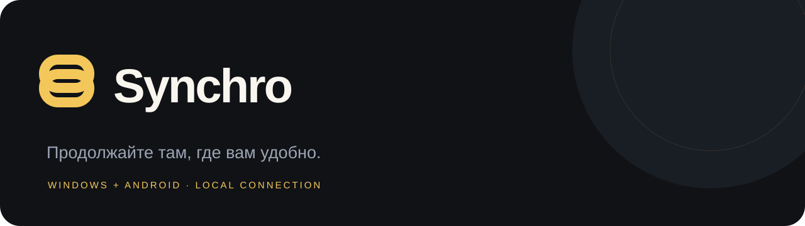
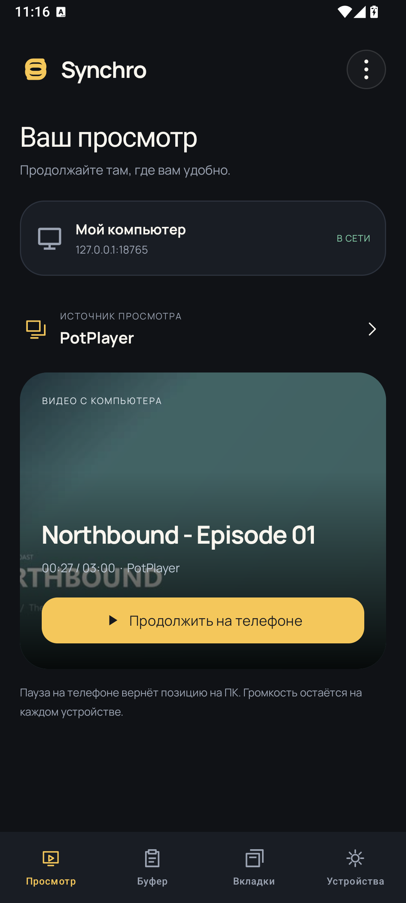
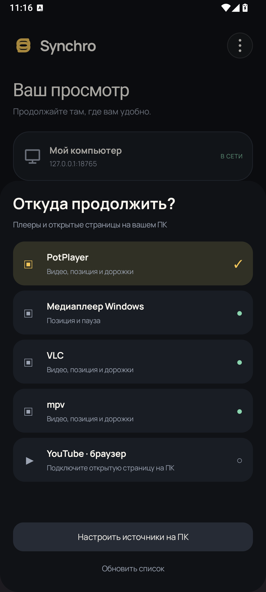
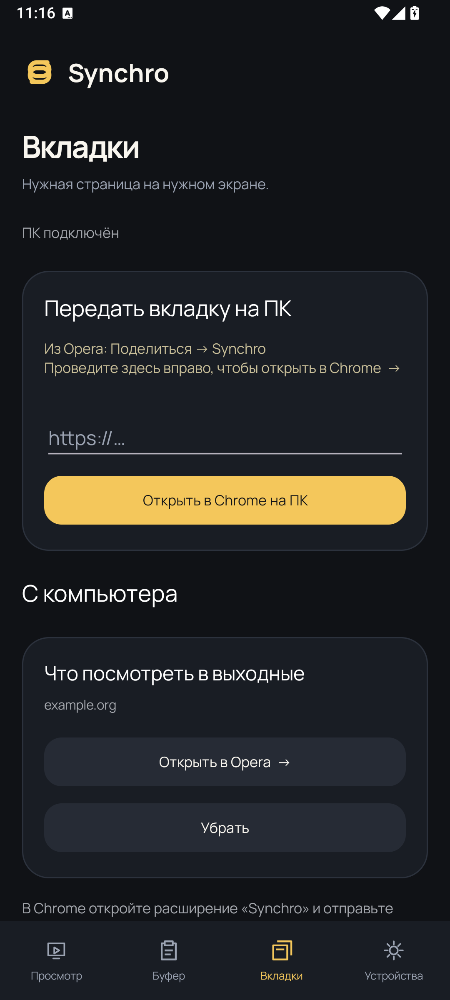
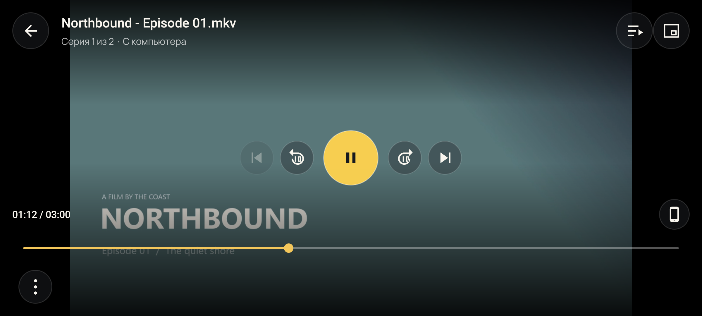
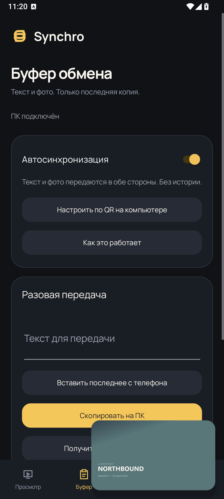

<p align="center"></p>
<p align="center"><a href="https://github.com/giveuper39/Synchro-Android/releases/latest"><strong>Скачать APK</strong></a> · <a href="https://github.com/giveuper39/Synchro-Desktop/releases/latest">Windows-сервис</a> · <a href="android/README.md">Сборка приложения</a></p>

Ваш просмотр, буфер и нужные вкладки — рядом, даже когда вы отошли от компьютера.

<p align="center">  </p>
<p align="center"><sub>Реальные экраны Synchro 0.4.0. Демонстрационное видео и локальный тестовый компьютер.</sub></p>

## От компьютера к телефону

Откройте фильм на ПК и нажмите **Продолжить на телефоне**. Компьютер поставит его на паузу, а приложение начнёт с того же момента. Когда поставите паузу на телефоне, серия и позиция вернутся на ПК.

В 0.4.0 источник выбирается прямо в приложении: **PotPlayer, Медиаплеер Windows, VLC, mpv или подключённая страница YouTube**. Доступные настройки зависят от источника: например, Media Player возвращает позицию и паузу, а PotPlayer/VLC/mpv также передают встроенные дорожки и задержку субтитров.

Локальное видео воспроизводится в LibVLC: полноэкранный режим, двойное касание для перемотки, прозрачные элементы управления и панели дорожек. Кнопки громкости управляют только телефоном. При сворачивании появляется системный мини-плеер с Play/Pause; закрытие сохраняет позицию на ПК.

<p align="center"> </p>

YouTube играет в официальном встроенном плеере. Установите единое расширение Synchro из раздела «Браузер» Windows-мастера: открытые ролики появятся автоматически. Клиент 0.4.3 совместим с этой возможностью Windows 0.4.4. Для YouTube мини-плеер не используется: уход с экрана ставит ролик на паузу и возвращает позицию. Некоторые ролики запрещают встраивание. Живой тест YouTube в среде разработки был заблокирован ошибкой TLS; [подробности коннектора](docs/YOUTUBE_CONNECTOR.md).

## Копировать между устройствами

**Текст и фотографии в обе стороны.** Копируйте на телефоне — вставляйте на ПК, и наоборот. Хранится только текущая копия; новая заменяет предыдущую. Истории в Synchro нет.

Автосинхронизация работает через разрешённый вами ADB-мост. Для разовой отправки используйте экран **Буфер** или «Поделиться → Synchro». Фото передаются как PNG с правильной ориентацией и без метаданных. Предел — 32 МиБ / 64 Мп. Ссылка на изображение передаётся как текст; фото должно быть скопировано именно как изображение или отправлено через «Поделиться».

**Вкладки.** В Opera выберите «Поделиться → Synchro», затем смахните карточку вправо или нажмите кнопку отправки. Ссылка откроется в Chrome на компьютере. В обратную сторону вкладку отправляет расширение Chrome; входящая карточка на телефоне открывается выбранным браузером. Можно передать и обычную ссылку из буфера.

## Подключение

1. Запустите [Synchro для Windows](https://github.com/giveuper39/Synchro-Desktop/releases/latest) в той же локальной сети.
2. Отсканируйте основной QR мастера обычной камерой или внутри Synchro. Ссылка откроет приложение либо страницу скачивания APK с вашего ПК. После установки вернитесь на эту страницу и нажмите «Открыть Synchro» — адрес и ключ сохранятся сами.
3. Для автоматического буфера откройте на телефоне **Беспроводную отладку → Сопряжение по QR-коду** и отсканируйте код мастера системным сканером.

Автоматический буфер требует системного ADB-разрешения, поскольку Android ограничивает фоновое чтение буфера обычными приложениями. Root и замена клавиатуры не нужны. После перезагрузки может понадобиться снова включить беспроводную отладку. Для просмотра и ручного обмена она не требуется.

## Обновление приложения

Откройте **Устройства → Обновления**. Synchro скачает стабильный APK из GitHub Releases, проверит SHA-256, версию, пакет и сертификат. Установку подтверждает Android. Подключение и настройки сохраняются при обновлении поверх опубликованной версии.

Android 8+ · ARM64 и x86-64 · интерфейс на русском. Приложение использует HTTP в доверенной LAN; ключ защищает доступ, но не шифрует Wi-Fi. Видео не копируется целиком для офлайн-просмотра.

## Разработка

JDK 21, Gradle 8.11.1, Android SDK 36 / Build Tools 35.0.0.

```sh
cd android
gradle :app:testDebugUnitTest :app:lintDebug :app:assembleDebug
```

На Windows `android/build-local.ps1 -JavaHome <JDK>` подготовит SDK и Gradle с проверкой архивов. Постоянный release-ключ хранится в GitHub Secrets и не входит в исходники.

| Компонент | Ответственность |
| --- | --- |
| `MainActivity`, `ReceiverUi`, `AppDesign` | Навигация, подключение и интерфейс |
| `PlaybackController`, `PipController` | LibVLC, дорожки, системный мини-плеер |
| `YouTubeActivity` | Официальный встроенный YouTube Player |
| `SyncActivity`, `ClipboardImages` | Текст, фото и вкладки |
| `ApiClient`, `UpdateActivity` | Протокол сервиса и обновления |
| `src/androidTest` | Проверки на эмуляторе: пауза/старт, смена серии, PiP и фотобуфер |

Java namespace — `dev.synchro.app`. Установочный `applicationId` сохранён для совместимости OTA. LibVLC 3.7.7 проходит проверку 16-КБ PT_LOAD и выравнивания ZIP, но имеет ограничение GNU_RELRO: полная совместимость со всеми 16-КБ устройствами не заявляется.

[Сборка и устройство приложения](android/README.md) · [Проверки](VALIDATION.md) · [Релизы](docs/RELEASING.md) · [Лицензии](THIRD_PARTY_NOTICES.md)

Собственный код — MIT. Это репозиторий Android-клиента; Windows-сервис развивается [отдельно](https://github.com/giveuper39/Synchro-Desktop).
