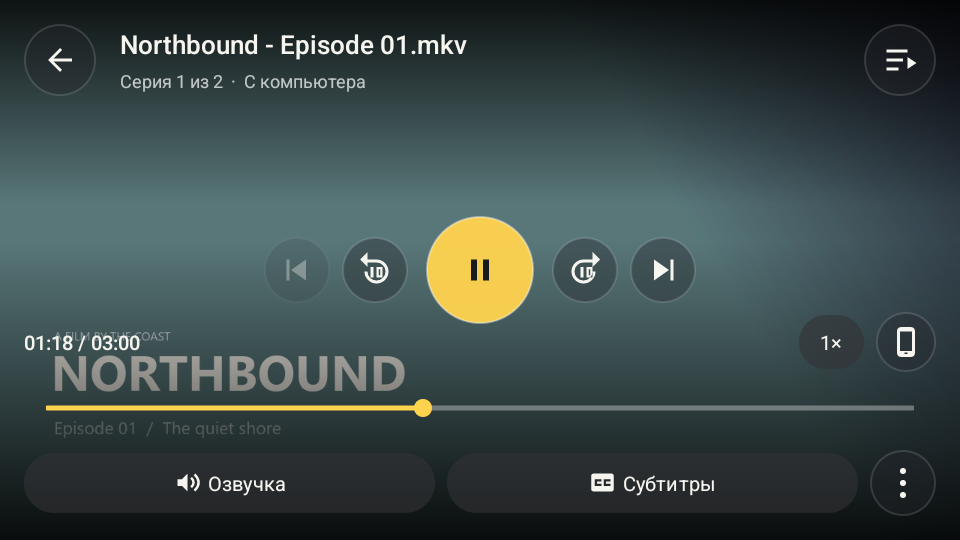
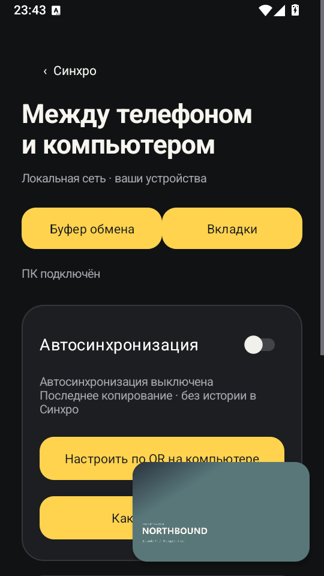

<p align="center"></p>
<p align="center"><a href="https://github.com/giveuper39/Synchro-Android/releases/latest">Android APK</a> · <a href="https://github.com/giveuper39/Synchro-Desktop">Windows service</a></p>

Продолжайте фильм с компьютера на телефоне. Пауза возвращает позицию на ПК; громкость остаётся на каждом устройстве.

<p align="center"> </p>
<p align="center"><sub>Экраны стабильной версии 0.3.0. Новый интерфейс появится в 0.4.0.</sub></p>

### На телефоне

- Полноэкранное видео, озвучка, субтитры и их задержка.
- Системный мини-плеер при сворачивании локального видео.
- Буфер обмена в обе стороны и отправка конкретного текста через «Поделиться».
- Входящие ссылки с ПК и отправка вкладки из мобильного браузера.
- QR-подключение и установка обновлений из приложения.

### Подключение

1. Запустите [Windows-сервис](https://github.com/giveuper39/Synchro-Desktop/releases/latest).
2. Установите APK и отсканируйте QR подключения. Адрес и ключ сохранятся автоматически.
3. Нажмите **Продолжить на телефоне**. Для возврата на ПК поставьте видео на паузу.

Автоматический буфер настраивается отдельно системным QR беспроводной отладки Android. Приложение не ведёт историю копирований.

### 0.4.0 — в работе

Новый экран просмотра с выбором источника, Windows Media Player, YouTube из открытого браузера и фотографии через системный буфер в обе стороны.

### Сборка

Android 8+ · ARM64 / x86-64. Для разработки: JDK 21, Gradle 8.11.1, Android SDK 36.

```sh
cd android
gradle :app:testDebugUnitTest :app:assembleDebug
```

Для релизов используется постоянный ключ подписи. Он хранится в Secrets; приватных ключей в исходниках нет.

[Сборка Android](android/README.md) · [Релизы и OTA](docs/RELEASING.md) · [Лицензии](THIRD_PARTY_NOTICES.md)

Собственный код — MIT. Воспроизведение локального видео — LibVLC.
